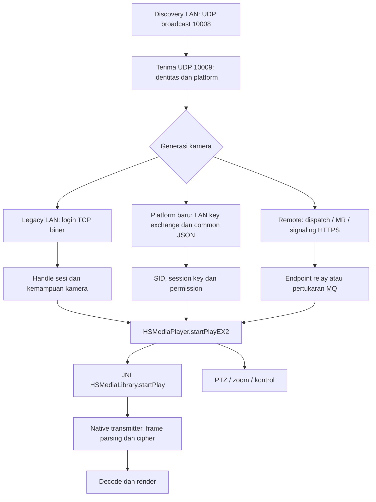

# Analisis V380 6.4.90 untuk Android client independen

**Bukti pengguna dan perbaikan0.2.1:** diagnostik client independen kini menunjukkan login/capability sukses serta frame render, diikuti putusnya sesi. Label AUTH FAILED versi lama tidak membedakan error stream. [Analisis disconnect](stream-disconnect.md) dan [bukti native](evidence/iot-disconnect-static.md) menjelaskan koreksi sparse cipher/feedback dan batas klaim. Pengujian koneksi tidak dijalankan ulang; kompatibilitas stabil belum terverifikasi.

**Pembaruan implementasi14 Oktober2026:** investigasi awal di bawah dipertahankan sebagai riwayat. Temuan yang kini terselesaikan (konstanta auth/padding/transformasi password, request303, X25519, V3 media/control, discovery biner dan AP setting) dijelaskan dalam [Legacy wire](legacy-wire-spec.md), [IoT LAN](iot-lan-protocol.md), dan [AP provisioning](ap-provisioning.md). Adapter nyata aktif pada APK debug; acceptance kamera pengguna belum lulus. Jalur fresh IoT PIN binding yang diamati memakai cloud; tidak ada bootstrap credential atau token akun yang diambil. Lihat [status implementasi](../IMPLEMENTATION.md).

Analisis statis dilakukan pada 13 Oktober 2026 menggunakan REA 6.4.0 dengan backend JADX headless 0.7.1, ditambah pemeriksaan ELF offline. Kesimpulan utama: **APK mendukung beberapa generasi komunikasi yang harus dipisahkan dalam client**. Dua repository pembanding memberi contoh protokol LAN yang berguna, tetapi tidak mewakili seluruh jalur APK ini.

**Pembaruan tahap implementasi:** [protocol-gate.md](protocol-gate.md) memulihkan konstanta1167/1168, transformasi password panjang, urutan I/O DEX yang benar, request303, pemilihan cipher V2 dan paket continuous PTZ. Fakta lanjutan tersebut menggantikan batas “belum dipulihkan” terkait di laporan awal ini. Gerbang kompatibilitas tetap belum lulus karena kamera pemilik belum diuji live; lihat [IMPLEMENTATION.md](../IMPLEMENTATION.md) untuk status aplikasi yang sebenarnya.

Input: `/home/husain/Downloads/v380-6-4-90.apk`; SHA-256 `7364691ba08427fd95b391c2b398aae66cd80eeb19c5bfd7aeaaba405dd2cc0b`. Package `com.macrovideo.v380`, versionName `6.4.90`, versionCode `122`, minSdk `24`, targetSdk `35`; inventaris JADX berisi 25.225 kelas. Bukti identitas: [package.json](evidence/package.json), Evidence ID `ev_5a4a59a232612f68272fbb910c1276eae7dc2e242fad9343db209f92b47b4a6e`.

APK tidak dimodifikasi atau dijalankan. Tidak ada login akun, pembacaan penyimpanan akun, koneksi kamera/cloud, maupun capture jaringan. Laporan tidak memuat nilai kredensial, token akun, ticket sesi, atau kunci. Nama field/parameter sesi dijelaskan hanya untuk memahami kontrak protokol. Bukti receiver yang mengandung literal kredensial bawaan diganti dengan excerpt tersanitasi yang secara eksplisit bukan Evidence kanonis.

**Cara membaca bukti:** “observasi APK” berarti deklarasi, pseudocode JADX, atau instruksi ELF statis; “observasi source” berarti kode repository pada commit tertentu; “inferensi” berarti penjelasan yang belum dibuktikan runtime. Nomor baris Java hasil dekompilasi bukan lokasi source asli. Bukti ELF pelengkap dibedakan dari Evidence REA. Indeks lengkap tersedia di [evidence-index.md](evidence-index.md).

## Alur komunikasi yang ditemukan

Diagram adalah gabungan hubungan statis tingkat subsystem, bukan rekaman satu sesi kamera. Pemilihan transmitter native dan hubungan langsung Java `VideoDecoder` dengan transmitter belum dibuktikan. Pada platform baru, cabang `pver >= 5 && !isP2PStart` dapat memakai pertukaran MQTT bahkan ketika perangkat berada di LAN; maka “kamera satu Wi-Fi” belum menjamin seluruh jalur vendor bebas cloud.

## 1. Device discovery pada LAN

`com.macrovideo.sdk.tools.DeviceLanUDPScanner` memiliki sender dan receiver terpisah. `startSearching(0)` mengaktifkan broadcast sender/receiver; pilihan lain mencakup group/all. `changeDevLanSearchProtocol(V380)` menetapkan request ASCII `NVDEVSEARCH^100`, prefix respons `NVDEVRESULT^100`, `NVDEVRESULT^200`, `NVDEVRESULT^300`, dan group search `NVGROUPSEARCH^100^`.

Sender mengirim ke port UDP `10008` melalui subnet/route broadcast dan `255.255.255.255`; socket sender juga bind `10008` dengan reuse. Receiver bind `10009`, timeout `200 ms`, buffer datagram `4096` dan receive-buffer `16384`. Selain respons text legacy, receiver menangani kandidat respons biner command `1280` melalui `Functions.parseResult`; respons text diarahkan ke `Functions.ParseDevice`. Perangkat disimpan/diperbarui menurut device ID. Pemetaan field dan batas parser dibahas dalam [discovery-ptz.md](discovery-ptz.md).

Bukti payload: `ev_d648d10a75955df73d5b8cecbd68f00f3e8b48d4a9547b8c64f679801e8351d7`; sender: `ev_ff93ad2c5f12d48352a075edfd5278c02d63a2955e00d5c70d4a2f4fe9fe7aab`; receiver tersanitasi diturunkan dari `ev_58da43d3c464389f6d5cd3ab537e9075116ecb2df136651f276a3ebe6aa59d75`.

**Perbandingan:** request dan port tujuan/receiver sejalan dengan `V380Decoder.DeviceDiscovery`, tetapi C# mengirim dari socket yang juga bind10009, sedangkan APK memakai sender10008 terpisah dari receiver10009. Android Java repository tidak memiliki `CameraDiscovery.java` pada commit yang diperiksa, meskipun README mencantumkannya. Jangan menjadikan format respons text `^100` sebagai parser universal untuk respons `^300` atau biner. Parser APK mengambil MAC di indeks2, IP3, port9 (fallback8800), device ID12, lalu metadata konfigurasi/jenis/binding/kemampuan pada indeks13–17; source C# mengambil subset dan tidak membaca port9.

## 2. Koneksi dan autentikasi kamera

`LoginHelper.lanLogin(DeviceInfo,int)` memanggil `GlobalDefines.changeDevPwd`, memvalidasi IP, lalu memanggil `LoginHelper.b(String,String,String,int,int)`. Jika nilai penanda `a == -100`, ada fallback ke overload `a(String,String,String,int,int)`. Isi transformasi `changeDevPwd` dan fallback tersebut belum diinspeksi; tidak diasumsikan sebagai hash tertentu. Bukti wrapper: `ev_418d8e7633868095c1ac727236a706b0071c9308bee570953212ca4d55c18e30`.

Pada `LoginHelper.b`, observasi layout request LAN:

| Offset | Ukuran | Isi yang ditulis pseudocode APK |
|---:|---:|---|
|0|4 LE|command melalui field statis `f`; nilai numerik belum diturunkan dari APK|
|4|4 LE|`120`|
|8|1|`31`|
|9|4 LE|`10`|
|13|4 LE|device ID|
|17|area string|waktu login LAN; area berikutnya mulai offset49|
|49|area string|username; area berikutnya mulai offset81|
|81|16|random key yang dibuat saat request|
|97|variabel|hasil enkripsi password dua tahap|
|total|520|buffer request yang dikirim|

Penulisan integer LE dikonfirmasi oleh `Functions.IntToBytes` (`ev_010e1da1f42c19b07685b0b7d16f0d29de7d748501c26ed1eecbe6b93764a9ff`). Username/time disalin dengan `arraycopy` tanpa batas panjang eksplisit pada potongan yang diperiksa: layout ini adalah observasi, bukan serializer yang aman untuk disalin begitu saja.

**Perbedaan kripto yang penting:** APK menjalankan `Functions.encrypt(Functions.encrypt(passwordBytes, protocolKey), randomKey)`. Method `Functions.encrypt` secara eksplisit memilih **`AES/ECB/PKCS5Padding`** (`ev_97e2d090fbe615c329e53eb048ae86f711ae4a375e6b472a7f2f782938c87c5d`). Kedua repository menggunakan zero-fill dan AES tanpa padding cipher. Karena padding dua tahap berbeda, implementasi repository belum terbukti setara byte-per-byte dengan APK. Nilai protocol key tidak diambil atau dicantumkan.

Parser respons membaca command offset0, result offset4, result value offset8, versi byte12, handle offset13, field sesi offset17, jenis perangkat/kamera byte21/22 dan capability flags termasuk audio/PTZ/speak. `LoginHandle` menampung hasil dan kemampuan, bukan hanya socket. Password error, ID error, dan kegagalan verifikasi memiliki pemetaan terpisah. Nilai sesi nyata tidak pernah tersedia dalam analisis ini.

Bukti `b`: [method-LoginHelper-b.json](evidence/method-LoginHelper-b.json), `ev_68a134a2ed8a9838f2f0b2679eaaee30301710cd9e2a9ac25b30248bc6809228`. **Batas bukti:** pseudocode method ini mengandung duplicated-block/type-inference warnings dan urutan read/write yang tidak konsisten. Layout penulisan dan field pembacaan terlihat, tetapi urutan eksekusi harus diverifikasi dengan DEX instruction tracing atau capture tersanitasi sebelum menjadi spesifikasi final. Nilai command `1167/1168` dikenal dari source pembanding; belum dinyatakan sebagai hasil pemulihan konstanta `f/g` APK.

Platform baru menyediakan `LoginHelper.keyExchangeByLanSync(ip,port,lanPassword)` melalui TCP. Request membentuk `act=1`, objek `verify` berisi `cKM`, `cS`, `tz`, `ts`; public-key bytes di-XOR dengan magic byte, lalu `cS` berasal dari SHA-256 atas hasil XOR diikuti password LAN. Response common header dibaca16B, kemudian JSON didekripsi/parsing dan diverifikasi melalui `Protocol.isResultOk`. Field `dK/dS` dipakai untuk pemeriksaan digest, lalu `ED25519Utils.getSKeyByte` menghasilkan bahan sesi bersama SID dan permissions. Nama helper tidak membuktikan detail algoritme kurva/key agreement; implementasi internalnya belum diperiksa.

Bukti key exchange: `ev_c43fdbdc570a5a9338d236fda296af170fd08058377511f101c14137adcba67a`; incoming refs `ev_9755ac39a945af3e4bded0d61cbb1d5bd3b8e78a7252bfc45d70df3ddfa0d0ec` mencakup `LoginHelper.login`, aktivitas penambahan kamera, setting, dan penanganan sesi kedaluwarsa. Ini autentikasi LAN kamera, terpisah dari akun cloud.

## 3. Struktur protokol TCP/UDP dan P2P

Ada sekurangnya tiga keluarga pesan yang harus dibedakan:

| Keluarga | Bukti APK | Struktur yang terlihat |
|---|---|---|
|Login LAN biner|`LoginHelper.b`|buffer520B, struktur pada tabel sebelumnya|
|Login MR JSON|`LoginHelper.a`, overload index2|header8B: magic LE `0xFE000300`, panjang LE, lalu JSON|
|Common IoT JSON/data|`Protocol.initCommonDataSendBuffer`|header16B, opsional outer envelope64B|

Login MR JSON memakai `method="login"`, request ID acak, version31, device ID, domain/port, username, representasi password base64, random key, connectType, securityLevel dan indeks P2P. Method tersebut memanggil `Functions.connectToMRServer2` dan memiliki fallback reconnect. Bukti `ev_3b9378916b495d705cdca37cc7c011724820a6b05c4c8960dcce758840c29672`; duplicated-block warnings membatasi kepastian detail cabang.

Header common16B ditulis sebagai berikut; offset relatif header internal:

| Offset | Ukuran | Makna observasi |
|---:|---:|---|
|0|4 LE|command|
|4|1|version dari low byte argumen short|
|5|1|secure type|
|6|1|session ID satu byte menurut nama parameter builder; call site key exchange memberi0|
|7|1|magic byte|
|8|4|tidak ditulis helper ini; belum diberi makna|
|12|4 LE|data size|
|16|data size|payload|

Jika outer envelope aktif, command `1200` berada di offset0 envelope dan panjang payload+16 di offset4; header internal dimulai pada offset64. `parseResponseHeader` hanya membaca command/version/secureType/dataSize. Pada key exchange LAN, command respons yang diperiksa `0x38030818`. Bukti layout: `ev_8ca8c9235b62f533ac86d8f0e2fe33180528cd7194e60a4a270cfae6014b2947`, parser `ev_7c0eb5cb7b6fb263690eb382b5e5db87156782e5d18c5ac1a34466ced4586e44`. `createCommonJsonRequestBuffer` membentuk common JSON, memakai `cipherJsonData` bila secureType1/2, lalu zero-fill buffer header sebelum menulis field; offset8–11 tetap nol dalam builder ini. Bukti `ev_ba28b4932b97302c9ad945b9973f73cb1ed8e467ee18f26b05546603ba0c0de6`. Pemetaan secureType ke algoritme dan seluruh JSON/media format belum dipulihkan.

`Functions.connectToMRServer2` memilih endpoint TCP explicit, cache/dispatch MR, daftar normal/panorama, dan fallback. Itu pemilih koneksi MR/relay; method tersebut belum membuktikan hole punching. `HSMediaPlayer.startPlayEX2` menunjukkan signaling HTTPS, MQ exchange, serta callback kesalahan MQ menuju permintaan memulai P2P. Native memiliki callback sejenis dan impor socket, tetapi hubungan socket dengan UDP media/NAT traversal belum terbukti. Rincian dan batas pencarian ada di [p2p.md](p2p.md).

**Yang belum diketahui:** format rendezvous, NAT classification, STUN/proprietary probe, UDP reliability/ACK/retransmission, keepalive P2P, autentikasi antar-peer, serta kondisi pemilihan direct/relay. P2P di sini tidak boleh disamakan dengan WebRTC, RTSP, atau UDP hole punching hanya berdasarkan namanya. Cloud path C# yang diperiksa adalah dispatch lalu TCP relay8800.

## 4. Negosiasi dan penerimaan live video

`HSMediaPlayer.startPlayEX2`, overload index0, menerima channel, stream type, video channel dan `LoginHandle`, menyiapkan state player, lalu memilih platform. Pada platform lama `protocolType=0`; pada platform baru `protocolType=2`. Cabang platform baru memakai MR/signaling dan, bila `pver>=5 && !isP2PStart`, MQ exchange dengan operation `live`. Endpoint, handle dan sesi hasil signaling diteruskan ke state player; setelah itu `HSMediaLibrary.startPlay(this)` dipanggil. MQ failure memanggil `onMqErrorStartP2p`. Bukti `ev_3ba10a3d2f85e6a919d9ae1ec8a2d1a6d384771c637e3a6ba1d7571be82b4f30`.

Inventaris player juga memuat `changeStream`, `changeVsChn`, `jniCallOnRecvMediaInfo`, `jniCallUpdateRenderData`, `refreshSession`, `updateLoginHandle` dan callback status/error. Keberadaan API ini menunjukkan kontrak kemampuan dan lifecycle; isi semua method tersebut belum ditelusuri.

Native `HSLiveDataV1/V2/V3Transmitter` menyediakan data-get/control thread dan parser versi; `HSLivePlayer` memiliki `onRecvFrameData` serta decode thread. Field paket media yang dibaca native belum dipulihkan hanya dari simbol. Referensi implementasi LAN memberi baseline berikut, **bukan spesifikasi APK yang sudah lengkap**:

1. TCP auth `1167 → 1168`, tutup auth socket, buat stream socket baru.
2. Stream login `301 → 401`, kemudian request `303`.
3. Reassembly header fragmen12B: marker0=`0x7F`, type1, fragCount u16LE@3, fragIndex u16LE@5, payLen u16LE@7; byte2/9–11 belum diterangkan.
4. Gabungkan fragmen lalu lepas header video16B. C# memparse frameId@0, frameType@4, fps@6, timestamp@8.
5. Dekripsi sesuai profil, kemudian Annex-B access units ke decoder.

Java reference menangani video `0x00/0x01` dan audio `0x16` dengan header4B; C# menangani video `0x00/0x01/0x28/0x29` dan audio `0x1A` dengan header16B. Kedua source juga berbeda dalam request303. Frame type, codec, timestamp unit dan layout audio kamera pengguna masih perlu verifikasi. Jangan membuat parser yang menebak satu layout berdasarkan panjang saja.

**Korelasi cipher native yang telah dibuktikan:** disassembly statis terbatas `libaes.so` arm64 mengonfirmasi AES-128 ECB decrypt. Pada `media_data_decrypt`, flag0 memproses64B setiap stride80B; flag nonzero memproses semua blok16B lengkap. `media_data_decrypt_pre_2k` membatasi ke2048B hanya untuk flag0. Pola ini cocok dengan primitive yang ditiru C#, sehingga dukungan dekripsinya memiliki dasar pada APK. Pemetaan flag0 ke video/nonzero ke audio, derivasi kunci dari sesi dan kapan primitive dipilih masih perlu bukti native caller. Instruksi, relocation dan offset tersimpan di [native-media-decrypt-disassembly.json](evidence/native-media-decrypt-disassembly.json); detail argument inference dan tail handling ada di addendum [native.md](native.md).

## 5. Pemanggilan native dan decoding

`HSMediaLibrary.<clinit>` memuat FAAD/FAAC, library FFmpeg, `mideaCodec`, `hsUtils`, `aes`, `HSMbedtls`, `hsMediaLibrary`, kemudian `initJavaVM`. Bukti `ev_a62d090583a4e2d7d0af1d2c69784f83d92feeaa5319048a31e6031f7b11522e`.

Pada ELF arm64 `libhsMediaLibrary.so`, JNI `HSMediaLibrary.startPlay` berada di VA/offset `0x969D0`, `stopPlay` `0x96B50`, `setPTZParam` `0x978F8`. Library tersebut mengimpor `initMediaDecoder/decodeFrameData/releaseMediaDecoder`; `libmideaCodec.so` mengekspor API identik dan decoder FFmpeg H.264/H.265. Ini bukti linkage/dependency, belum call graph runtime. Hash, ukuran fungsi, ABI dan batasannya ada di [native.md](native.md).

Java `VideoDecoder.init(width,height,Surface,codec)` memilih `1001 → video/avc`, `1004 → video/hevc`, memanggil `MediaCodec.createDecoderByType`, configure dan start. `decode → b` melakukan dequeue input/output, queue compressed bytes, lalu render ke Surface atau menyalin output buffer bila Surface null. Implementasi yang terlihat memberi timestamp input `0L`; client independen sebaiknya memakai PTS terdefinisi dari kamera. Bukti init `ev_7e092e42f3b7f5be906a202a96c4a3101b9ecb06f7809710c286ff00fc085960`; decode helper `ev_e740bd7857c9d31c023a0a0206fe3a713e999c2a7be0619ace043279c772b4c2`.

**Batas penting:** hubungan pemanggilan native langsung ke Java `VideoDecoder` dan aturan pemilihan hardware/software belum dibuktikan. `libffavc.so` mengekspos `org.ffavc.DecoderFactory.GetHandle`; itu tidak cukup untuk menghubungkannya dengan class `VideoDecoder`. Untuk client LAN independen, decoder vendor tidak perlu dijadikan dependensi: MediaCodec menerima H.264/H.265 setelah framing, dekripsi, dan access-unit boundary benar.

## 6. PTZ dan kontrol kamera

API relevan: `HSMediaPlayer.setPTZAction`, `SendZoomAction`, `callPTZXLocation`, `PTZXController`, serta JNI `HSMediaLibrary.setPTZParam/setPTZXParam/setZoomParam`. `setPTZAction` memeriksa indeks player0–3 lalu meneruskan empat boolean ke `HSMediaLibrary.setPTZParam`; nama parameter arah tidak tersedia. Bukti `ev_553a3451e530d1a001103d08f8429d4f665d9adc28cb40e4a19f2a652b76d1d4`. Ini menempatkan kontrol pada sesi player, terpisah dari decoder. Rincian parameter dan call-through APK tersedia di [discovery-ptz.md](discovery-ptz.md).

Preset memiliki jalur yang lebih jelas: `callPTZXLocation` meneruskan action103 ke native; `setPTZXLocation` memanggil controller dengan action102. Nama caller mendukung interpretasi103=recall,102=save. `PTZXController.setPTZXPoint` pada versi legacy yang lebih baru membentuk request256B command329@0, deviceID@4, nilai1 pada byte8, handle@9, action@13, presetID@17, channel@21; response32B command429. Versi lama memakai129/229. Controller preset dapat membuka socket command tersendiri, berbeda dari continuous PTZ pada sesi media. Platform baru memakai action JSON `DAID_PT_PRESETS_CTRL` dengan `ctrl_flag`, `pos_mark_id_cnt`, `pos_mark_id` dan channel mask; action104 memakai `DAID_PT_RECAL`. Bukti `ev_864228b5a8ef62dc2348c061a61434454cf9d2c134bc6c65cfe12e724209076c`. Duplikasi/inversi kondisi JADX membatasi kepastian retry dan ambang pemilihan versi, sehingga layout ini perlu diuji per profil.

C# menyediakan contoh wire command PTZ16B: command u32LE `170/0xAA`; horizontal word@8 bernilai kiri1001/kanan1002, vertical word@10 atas1003/bawah1004, stop1000 untuk keduanya. Lampu196, image mode197, flip190 juga tersedia. Paket dikirim melalui stream socket terautentikasi; ACK gerakan tidak diparse. Ini observasi source pembanding, belum bukti bahwa seluruh kamera/platform APK memakai command yang sama. Preset/cruise/platform baru memerlukan profile/control codec tersendiri.

## Perbandingan yang menentukan desain

Commit referensi: Android `afe9b13f1e119efa15d41fa604bae6a38f1d6fe7`; C# `14cb20fe70cf4c5639bbf15d3cfe453680c516ed`. Analisis source lengkap dengan permalink per baris: [comparison.md](comparison.md).

| Area | umar14/v380-android | PyanSofyan/V380Decoder | Implikasi dari APK |
|---|---|---|---|
|Discovery|file implementasi tidak ada|UDP legacy|APK juga menerima generasi text/biner lain|
|Auth request|256B, field/version lama|520B, versi31|APK520B dengan offset9=10; padding AES berbeda|
|Media cipher|tidak ada|decrypt sesuai deviceVersion/communicationVersion|primitive AES128 ECB dan64/80 cocok; pemilihan aktif perlu verifikasi|
|Remote|tidak ada|dispatch + TCP relay|APK juga memiliki HTTPS/MQ/session exchange|
|Decoder|MediaCodec H.264|RTSP repackaging + snapshot decoder|APK memiliki Java AVC/HEVC dan native FFmpeg|
|Kontrol|tidak ada|PTZ/lampu/flip|APK lebih luas, native + platform-aware|

Jangan menyalin parser source tanpa perbaikan: TCP read parsial/gabungan pesan harus ditangani; status sukses wajib divalidasi; panjang respons401 harus cukup untuk seluruh field yang dibaca; reassembly wajib memeriksa count/index/frame budget. Java reference memiliki `recvAtLeast` yang hanya satu kali read, sedangkan C# tidak memvalidasi urutan fragmen secara lengkap. Perbedaan padding/password layout, audio, request303 dan media version memerlukan fixture per profil.

## Rekomendasi Android modular

Mulai dengan **satu aplikasi dan paket logis**, tanpa SDK native vendor atau P2P cloud sebagai syarat MVP. Pisahkan implementasi berikut agar wire variants tidak merembet ke UI:

| Paket | Tanggung jawab |
|---|---|
|`discovery`|Wi-Fi interface, broadcast, parser text/biner, dedup dan kemampuan perangkat|
|`protocol`|LE message codec, batas ukuran, profile versi, incremental TCP parser dan reassembly|
|`session`|discovered → connecting → authenticating → ready → streaming → reconnecting; cancel, timeout, session refresh|
|`transport`|TCP LAN dengan deadline/cancellation; adapter relay/P2P baru setelah protokol terbukti|
|`media`|cipher per profile → access-unit parser → bounded queue → MediaCodec → Surface|
|`control`|PTZ/zoom/light/flip menggunakan sesi yang sama; fail-safe stop|
|`ui`|pemilihan kamera, kredensial yang pengguna masukkan, status dan lifecycle Surface|

Model frame minimal membawa codec, channel, keyframe, PTS dan compressed bytes. Pisahkan cipher dari decoder: byte terenkripsi bukan error codec. Tentukan profil dari capability/version dan respons yang tervalidasi, bukan tebakan nama produk “V380”. Validasi username/password encoded length sebelum serialisasi. Gunakan logging tersanitasi; jangan mencetak password, session key, ticket atau respons auth lengkap. Android Keystore dipakai untuk melindungi data rahasia yang memang perlu disimpan, dengan ciphertext berada di penyimpanan app.

Urutan implementasi: discovery legacy + input IP manual → satu profil auth LAN yang diverifikasi → stream login/reassembly/cipher → MediaCodec AVC/HEVC → PTZ. Tambahkan platform baru/MQ/relay dan P2P setelah kebutuhan kamera pengguna serta handshake terbukti. Ini pembagian tanggung jawab; belum memerlukan tujuh Gradle module atau abstraction/plugin framework.

PTZ harus mengirim stop saat tombol dilepas, gesture dibatalkan, app pause, timeout dan sebelum disconnect. Batasi durasi gerakan dan kirim perintah secara berurutan. Reconnect mereset parser, decoder dan sesi; tunggu keyframe kembali. Decoder queue harus terbatas untuk menjaga latency, bukan menyimpan backlog tanpa batas.

Verifikasi implementasi berikutnya memakai fixture sintetis/tersanitasi: partial/coalesced TCP read, header terpotong, panjang/fragCount invalid, fragmen hilang/duplikat, cipher block boundaries, mismatch profile, kode auth gagal, EOF, session expired, rotasi Surface dan PTZ stop. Uji live terhadap kamera pengguna diperlukan untuk menyatakan interoperabilitas; analisis ini tidak melakukan uji tersebut.

## Status enam fokus dan pekerjaan yang masih terbuka

| Fokus | Status berdasarkan bukti |
|---|---|
|Discovery LAN|payload/port dan alur receiver terbukti statis; kompatibilitas semua model belum diuji|
|Koneksi/auth|jalur LAN biner, MR JSON, dan LAN key exchange ditemukan; konstanta command tertentu, transformasi password awal dan detail handshake belum lengkap|
|TCP/UDP/P2P|beberapa envelope TCP dan discovery UDP dipulihkan; mekanisme P2P direct/NAT belum direkonstruksi|
|Live stream|Java dispatch→JNI terbukti; format media referensi tersedia, mapping native/varian belum lengkap|
|Decoder native|API JNI/dependency dan decoder Java AVC/HEVC ditemukan; pemilihan runtime/bridge belum pasti|
|PTZ/kontrol|API APK dan baseline paket C# tersedia; wire mapping semua platform/ACK belum dipastikan|

Langkah pembuktian berikutnya yang paling bernilai: native function analysis pada transmitter dan cipher, DEX instruction tracing untuk method login yang gagal didekompilasi bersih, lalu capture tersanitasi satu kamera milik pengguna dengan skenario discovery→login→SD/HD→PTZ stop. Identitas firmware/model dan trace tersebut akan menentukan profil LAN yang layak diimplementasikan lebih dahulu. Tidak diperlukan ekstraksi token akun atau modifikasi APK untuk tahap itu.
