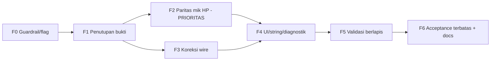

# Rencana Implementasi & Perbaikan Talkback

Tanggal: 16 Oktober 2026.
Status: rencana; belum ada perubahan kode sumber.
Rujukan: [`talkback-wire.md`](talkback-wire.md), [`talkback-implementation-plan.md`](talkback-implementation-plan.md),
`../tools/talkback-oracle/README.md`, `../validation/talkback-oracle/results.json`,
`../validation/talkback-noise/results.json`.

## 0. Ringkasan masalah (hasil analisis)

1. **Gerbang sengaja menutup kamera pemilik.** `session/CameraSession.kt` → `talkbackBlock()` mengembalikan
   `TalkbackError.FORMAT_UNVERIFIED` saat `talkbackAudio.value?.codec == 102`, sebelum recorder dibuat atau
   start request ditulis. Kamera yang diamati mengumumkan codec102, sehingga tombol tidak pernah mengirim.
2. **Front-end mikrofon berbeda dari vendor.** Bukti `analysis/evidence/talkback-HSMediaPlayer-startSpeak.sanitized.json`
   menunjukkan vendor memakai audio focus, `setMode(MODE_IN_COMMUNICATION)`, `setSpeakerphoneOn(true)`,
   `EchoCanceller`, dan `AudioRecord` sumber `VOICE_COMMUNICATION (7)`/`MIC (1)`. Project tidak memakai satu pun
   (grep `AudioManager|AudioTrack|EchoCancel|VOICE_COMMUNICATION|setMode|Speakerphone` pada `app/src/main/**` = nol).
   `media/TalkbackRecorder.kt` hanya memakai `AudioSource.MIC` tanpa AEC.
3. **Kontrak wire sudah cocok byte-of-byte tetapi belum tentu jalurnya.** Oracle membuktikan encoder2001/framing/
   envelope identik dengan vendor, tetapi jalur sesi resmi (LAN-V3 vs P2P/MQ), sumber nilai pemilih encoder uplink
   (`down.aattr.codec`), dan peran AEC belum terbukti.
4. **Perbedaan state/timing kecil**: encoder ADPCM per-attempt (index 0) vs global vendor; capture dimulai setelah
   ACK 197123 vs vendor langsung.

## 1. Keputusan yang sudah disetujui

- **D1.** Observasi jalur sesi aplikasi resmi **diizinkan** (Fase 1).
- **D2.** Prioritas: **Fase 2 (paritas AEC/audio-mode)** lebih dulu — mandiri, tidak bergantung keputusan transport.
- **D3.** **Mode bounded probe** untuk acceptance: maksimum 15 frame hening / 500 ms, deadline pembatalan independen,
  berhenti pada noise pertama; uji ucapan terpisah ≤2 detik.
- **D4.** Siap menerima kemungkinan kesimpulan "jalur LAN-V3 uplink tidak layak di unit ini" (fitur tetap terkunci codec102).

## 2. Guardrail (mengikat)

- Fail-closed: `codec102 → FORMAT_UNVERIFIED` dipertahankan sampai kontraknya terbukti.
- Tidak ada probe codec otomatis, retry otomatis, atau codec sweep (sesuai `tools/talkback-oracle/README.md`).
- Tidak menghubungi kamera sebagai rutin validasi; acceptance fisik hanya lewat sesi terbatas yang dipicu pengguna.
- Perubahan hanya di keluarga IoT/V3 LAN; Legacy/cloud tidak disentuh.
- Semua copy baru bilingual (`values/strings.xml` + `values-en/strings.xml`) dalam perubahan yang sama.
- Diagnostik hanya enum/angka dari allowlist; tanpa payload, SID, kunci, atau audio.
- Semua jalur baru di balik flag debug agar bisa dimatikan.

## 3. Peta fase



---

## Fase 0 — Guardrail & flag (fondasi)

**Tujuan:** semua perubahan dapat dimatikan tanpa menyentuh perilaku produksi.

- Tambah flag debug (via `buildConfigField`): `TALKBACK_MIC_FRONTEND_V2` dan `TALKBACK_PROBE_ENABLED`, default `false`.
- Jangan ubah `talkbackBlock()`.

**File:** `app/build.gradle.kts`, `session/CameraSession.kt`.
**Kriteria lulus:** build debug + lint hijau; perilaku tidak berubah saat flag `false`.

## Fase 1 — Penutupan bukti (dokumenter + observasi terbatas)

**Tujuan:** memutus dua ketidakpastian penentu sebelum koreksi wire.

Statis (tanpa kamera):
1. Disassembly ulang native untuk memastikan field yang mengisi pemilih encoder uplink (bukan hanya asumsi
   `+0x400..0x40c`) dan pemetaan input `21`/kodek di `0x4e670..0x4e948` + `parseLiveMediaInfo 0x9436c..0x943f0`.
2. Arsipkan excerpt baru dengan Evidence ID di `analysis/evidence/`; perbarui `analysis/evidence-index.md`.

Observasi (disetujui, D1; dari sisi HP, tanpa tulis ke kamera):
3. Bandingkan talkback app resmi: **Wi-Fi sama (LAN)** vs **data seluler (remote/P2P/MQ)** pada kamera yang sama.
4. Catat `aattr` sesi aktual lewat reader produksi (`TalkbackCameraObservationTest`), hanya ringkasan metadata
   (tanpa SID/kunci/audio/video).

**Deliverable:** keputusan tertulis di `analysis/talkback-wire.md`:
- Kontrak A: pemilih encoder uplink = f(`down.aattr`) atau konstanta lain.
- Kontrak B: jalur sesi resmi = LAN-V3 atau P2P/MQ.
**Kriteria lulus:** tiap keputusan punya bukti eksplisit; bila tiada bukti, fitur tetap terkunci.
**Risiko:** bila sukses app resmi hanya via P2P/MQ → Fase 3 berubah arah/berhenti.

### Status Fase 1 — 16 Oktober 2026

- **Kontrak A: DIBUKTIKAN (statis).** Field `+0x400` (aattr transmitter) mengisi pemilih encoder; `cmp w8, #0x64`,
  non-100 → `encodeFrameData`. Proyeksi: `analysis/evidence/talkback-codec-select.sanitized.json`; dicatat di
  `analysis/talkback-wire.md` dan `analysis/evidence-index.md`. Landasan langkah 1 selesai.
- **Kontrak B: BELUM.** Perlu observasi dari sisi perangkat pengguna (langkah 3–4). Gate codec102 tidak diubah.

### Perintah observasi (perlu dijalankan oleh Anda)

Observasi metadata sesi aktual (konek ke kamera tersimpan; tanpa mikrofon/PTZ, tanpa simpan video):

```bash
./gradlew :app:connectedDebugAndroidTest \
  -Pandroid.testInstrumentationRunnerArguments.class=dev.cctv.v380.TalkbackCameraObservationTest \
  -Pandroid.testInstrumentationRunnerArguments.observeCamera=true \
  -Pandroid.testInstrumentationRunnerArguments.cameraHost=<IP-KAMERA>
```

Hasil ringkasnya ditulis ke `files/talkback-envelope-observation.json` di cache aplikasi; ambil dengan:

```bash
adb -s 3d97bee3 shell run-as dev.cctv.v380 cat files/talkback-envelope-observation.json
```

Perbandingan transport (dilakukan manual oleh Anda, tanpa alat otomatis):
1. Jalankan talkback **aplikasi V380 resmi** ke kamera yang sama saat HP di **Wi-Fi yang sama (LAN)**.
2. Ulangi saat HP memakai **data seluler** (kamera diakses remote/P2P/MQ).
3. Catat: apakah jelas di kedua kondisi, hanya salah satu, atau tidak sama sekali.

Yang dilaporkan cukup: (a) kondisi mana yang berhasil, (b) isi `talkback-envelope-observation.json`
(nilai `capability`, `metadataBlock`, dan `observations[].codec/sampleRate`). Tanpa kredensial/SID/kunci/audio.

## Fase 2 — Paritas front-end mikrofon (PRIORITAS, mandiri)

**Tujuan:** menyetarakan perekaman mikrofon HP dengan vendor secara fungsi (fokus audio, mode, AEC, pemilihan sumber),
tanpa mengubah wire.

### 2.1 Desain komponen

Komponen baru `media/TalkbackAudioSession.kt` (interface + impl Android + no-op):

```
interface TalkbackAudioSession : AutoCloseable {
    fun acquire(): Boolean          // AudioManager: request focus (STREAM_VOICE_CALL, GAIN_TRANSIENT)
    fun recordSource(): Int         // VOICE_COMMUNICATION bila AEC memungkinkan, else MIC
    fun attach(listener: (Int) -> Unit) // lapor audioSessionId untuk AEC
    override fun close()            // restore mode/speakerphone, abandon focus (idempoten)
}
```

- `TalkbackAudioSession.android(context)`: bungkus `AudioManager`.
  - `acquire()`: `requestAudioFocus` (API26 `AudioFocusRequest`, else deprecated `requestAudioFocus(null, 3, 2)`);
    simpan mode awal; set `MODE_IN_COMMUNICATION`; `setSpeakerphoneOn(true)` (keputusan: lihat 2.4).
  - `recordSource()`: `AudioSource.VOICE_COMMUNICATION` jika `AcousticEchoCanceler.isAvailable()` true, else `MIC`.
  - `close()`: `AcousticEchoCanceler.release()`, restore mode/speakerphone, `abandonAudioFocus`.
  - Semua operasi aman bila `AudioManager`/AEC tidak tersedia atau dipanggil berulang.
- `TalkbackAudioSession.NO_OP`: dipakai default di JVM test / konstruksi tanpa konteks.

### 2.2 Integrasi ke recorder

`media/TalkbackRecorder.kt`:
- `android(sampleRate, audio: TalkbackAudioSession)`.
- Pakai `audio.recordSource()` saat membuat `AudioRecord` (pertahankan batas buffer yang ada).
- Setelah `AudioRecord` dibuat: `AcousticEchoCanceler.create(record.audioSessionId)`; `enable()` bila tersedia.
  Opsional `NoiseSuppressor` (keputusan 2.4).
- `acquire()` sebelum `startCapture()`, `close()` di jalur rilis yang ada (`releaseCapture`/`close`).
- Tidak ada mikrofon aktif tanpa aksi pengguna; AEC selalu dirilis di semua jalur cleanup.

### 2.3 Seam injeksi & wiring

`session/CameraSession.kt`:
- Tambah `private val talkbackAudioFactory: () -> TalkbackAudioSession = { TalkbackAudioSession.NO_OP }` (mirip
  `talkbackRecorderFactory` yang sudah ada; lambda lazy agar JVM test aman).
- Teruskan session ke `TalkbackRecorder.android(sampleRate, audio)` di dalam attempt.
- `ui/CameraViewModel.kt`: konstruksi nyata memakai
  `CameraSession(..., talkbackAudioFactory = { TalkbackAudioSession.android(getApplication()) })`.

### 2.4 Keputusan teknis dalam Fase 2

- `setSpeakerphoneOn(true)`: vendor menyalakannya untuk pemutaran audio kamera (yang belum didukung client). Opsi:
  (a) tiru penuh untuk paritas rute, atau (b) hanya `MODE_IN_COMMUNICATION` + AEC. Rekomendasi: **(b)** untuk
  meminimalkan perubahan state perangkat; catat sebagai perbedaan.
- `NoiseSuppressor`/`AutomaticGainControl`: vendor tidak eksplisit; tawarkan sebagai default **off** (opt-in).
- `MODIFY_AUDIO_SETTINGS`: `setMode`/`setSpeakerphoneOn` memerlukan permission normal ini → tambahkan ke
  `AndroidManifest.xml` **hanya bila** opsi (a) atau `setMode` dipakai (ya, `setMode` dipakai).
- `N0`/`isAecEnable` vendor tidak dipetakan literal (EchoCanceller vendor proprietary); gunakan padanan platform.
  Dokumentasikan perbedaan ini secara eksplisit.

### 2.5 Test

- JVM (`app/src/test/...`): fake `TalkbackAudioSession` mencatat urutan `acquire → startCapture → … → close`,
  verifikasi sumber terpilih, `close` dipanggil pada semua jalur (stop/cancel/error/release) dan tepat sekali.
- Android sintetis (`app/src/androidTest/...`): verifikasi `TalkbackAudioSession.android` mengembalikan mode saat
  `close`, idempoten, dan aman tanpa mikrofon nyata (tanpa kamera).

**File:** `media/TalkbackAudioSession.kt` (baru), `media/TalkbackRecorder.kt`, `session/CameraSession.kt`,
`ui/CameraViewModel.kt`, `app/src/main/AndroidManifest.xml`, test terkait.
**Kriteria lulus:** seluruh test di atas lulus; tidak ada regresi test talkback/PTZ/live; flag `false` = perilaku lama.
**Risiko:** perubahan mode audio global; mitigasi = restore terjamin + idempoten + dirilis di `finally`.

## Fase 3 — Koreksi jalur wire (setelah Fase 1)

Cabang berdasarkan hasil Fase 1:

- **Kontrak A berbeda:** ubah pemilihan payload di `runTalkback` (`if (codec == 102) encoder = TalkbackAdpcmEncoder()`)
  agar mengikuti field terbukti; `IoTTalkbackProtocol.startParams` mengikuti native.
- **Kontrak B = non LAN-V3:** hentikan uplink LAN, tandai unsupported untuk transport itu, dokumentasikan.
- **Kontrak A & B benar (dugaan: masalah di front-end/timing):**
  - **Timing capture:** selaraskan dengan vendor — mulai capture paralel saat start, jadikan ACK 197123 gerbang
    *kirim* (bukan gerbang *rekam*).
  - **Bounded probe (D3):** mode debug khusus acceptance — kirim maksimum 15 frame hening/500 ms, deadline
    pembatalan independen, berhenti pada noise pertama. Bukan jalur produksi.
- **ADPCM state:** tetap index 0 per-attempt; jangan introduksi state global lintas sesi.

**File:** `protocol/IoTTalkbackProtocol.kt`, `media/TalkbackAdpcmEncoder.kt`, `session/CameraSession.kt`.

## Fase 4 — UI, string, diagnostik

- `ui/TalkbackControls.kt`: state/error baru (mode uji, "AEC tidak tersedia", "transport tidak mendukung");
  "Mikrofon aktif" tetap berarti capture lokal, bukan bukti speaker berbunyi.
- `values/strings.xml` + `values-en/strings.xml`: seluruh string baru dalam satu perubahan.
- `session/Diagnostics.kt`: detail baru (mis. `TALKBACK_AUDIO_ROUTE`, `TALKBACK_AEC`, `MIC_AEC_UNAVAILABLE`)
  dengan enum/angka saja.
- Aksesibilitas: target 48 dp, live region polite, tema terang/gelap, font besar, landscape.

## Fase 5 — Validasi berlapis

1. `./gradlew :app:testDebugUnitTest`
2. `./gradlew :app:assembleDebug :app:assembleDebugAndroidTest :app:lintDebug`
3. Regresi oracle offline bila relevan (`tools/talkback-oracle`).
4. Simpan bukti di `validation/talkback-fix/` (revisi sumber, perintah, hasil aktual, batas; bedakan sintetis vs historis).

## Fase 6 — Acceptance fisik terbatas + dokumentasi

1. Acceptance dipicu pengguna (D3, D4): kirim hening terbatas → stop menghentikan suara → tidak hidup lagi setelah
   reconnect; uji ucapan ≤2 detik terpisah.
2. Perbarui `PRODUCT.md`, `DESIGN.md`, `IMPLEMENTATION.md`, `readme.md`, `analysis/talkback-wire.md` sesuai status
   nyata (nyatakan "belum terverifikasi" bila belum).
3. Bila gagal, kembali ke Fase 1 dengan bukti baru; jangan memperluas klaim.

## 4. Register risiko

| Risiko | Dampak | Mitigasi |
|---|---|---|
| Perubahan mode audio global bocor | Audio perangkat lain terganggu | Restore idempoten di `finally`; reacquire aman |
| AEC platform tidak tersedia di perangkat | Tidak ada cancel echo | Fallback `MIC`; tampilkan status; tetap eksperimental |
| Jalur sesi resmi ternyata P2P/MQ | Upaya LAN-V3 sia-sia | Fase 1 memutus lebih dulu; siap hentikan (D4) |
| Encoder uplink bukan turunan `down.aattr` | Payload salah → decitan | Fase 1 Kontrak A; gate tetap sampai terbukti |
| Interpretasi AEC/route vendor tak terverifikasi | Klaim berlebih | Dokumentasi batas; hanya perangkat pemilik yang mengonfirmasi |

## 5. Urutan eksekusi yang direkomendasikan

F0 → F2 (paritas mik, mandiri) → F1 (bukti paralel) → F3 (koreksi wire sesuai temuan) → F4 → F5 → F6.

## Status eksekusi — 16 Oktober 2026

- **Fase 0 — selesai.** Flag `TALKBACK_MIC_FRONTEND_V2` dan `TALKBACK_PROBE_ENABLED` (default nonaktif).
- **Fase 2 — selesai.** `media/TalkbackAudioSession.kt` (audio focus, mode komunikasi, AEC platform), seam `talkbackAudioFactory`, wiring ViewModel, permission `MODIFY_AUDIO_SETTINGS`; flag-gated. Tes JVM + `TalkbackAudioFrontendTest` (perangkat fisik).
- **Fase 1 — statis selesai; observasi tertunda.** Kontrak A dibuktikan statis (lihat bagian Fase 1 dan `analysis/talkback-wire.md`). Kontrak B menunggu perbandingan transport aplikasi resmi oleh pengguna.
- **Fase 3 — sebagian, sesuai guardrail.** Tidak ada perubahan framing/format spekulatif karena Kontrak B terbuka. Probe acceptance terbatas (15 frame hening, berhenti sendiri, tanpa mikrofon) diimplementasikan di balik `TALKBACK_PROBE_ENABLED` dan tidak membuka gate codec102.
- **Fase 4 — selesai.** Tombol probe debug + catatan bilingual; detail diagnostik `TALKBACK_PROBE_START`/`TALKBACK_PROBE`.
- **Fase 5 — selesai (offline).** Suite offline resmi lulus; tes probe dieksekusi dengan flag; bukti di [`validation/talkback-fix/results.json`](../validation/talkback-fix/results.json).
- **Fase 6 — dokumentasi diperbarui.** IMPLEMENTATION/PRODUCT/DESIGN/readme/wire. Acceptance speaker fisik tetap belum dijalankan (menunggu Kontrak B).

## Hasil acceptance pemilik — 16 Oktober 2026

- Kontrak B terjawab: jalur **IoT/V3 LAN** pada kamera pemilik **berfungsi**. Probe hening menghasilkan reaksi audible, dan **uji ucapan2 detik membuat suara mikrofon terdengar jelas di speaker kamera**.
- Gate codec102 `FORMAT_UNVERIFIED` **dihapus**; front-end mikrofon vendor kini **default** (`TALKBACK_MIC_FRONTEND_V2`). Probe terbatas tetap ada di balik `TALKBACK_PROBE_ENABLED`.
- Batas: laporan pemilik tunggal (bukan pengukuran berulang); belum ada klaim latensi, ketahanan, atau firmware lain. Bukti: [`validation/talkback-fix/results.json`](../validation/talkback-fix/results.json), kontrak [`analysis/talkback-wire.md`](talkback-wire.md).
